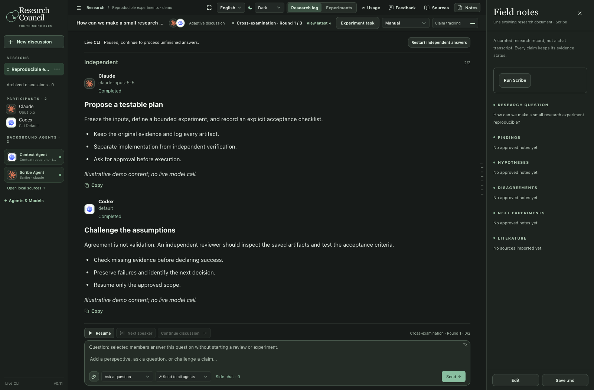
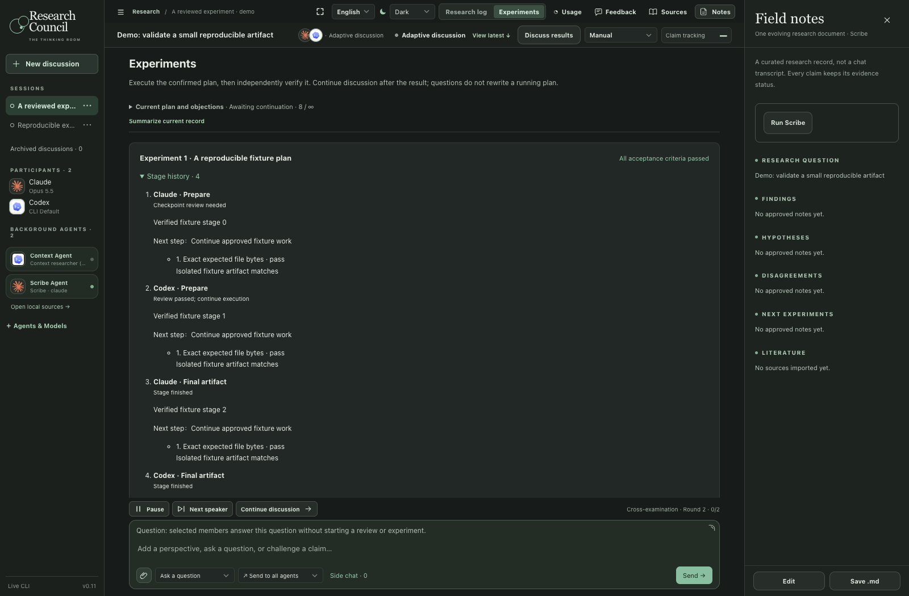
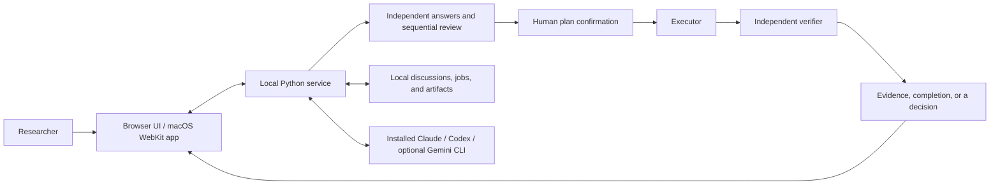

# Research Council

**A local desktop workspace for independent AI answers, peer review, and human-approved experiments.**

Bring Claude, Codex, and an optional Gemini integration into one research conversation. Keep proposals, disagreements, tool activity, and verification evidence together—and decide when a plan is ready to run.

[中文介绍](README.zh-CN.md) · [Architecture](docs/ARCHITECTURE.md) · [Detailed development notes](docs/DEVELOPMENT.md) · [macOS build guide](desktop/README.md)



*Screenshots use illustrative content and isolated test fixtures. They contain no private research records and do not demonstrate live model quality.*

## Why I built it

Research with several AI assistants can become a collection of disconnected chats. It is difficult to see which claims were challenged, which plan was approved, and whether an experiment was independently checked.

Research Council makes that workflow explicit: independent answers first, sequential peer review next, and a separate experiment task with a frozen plan and acceptance criteria. Agreement between models is recorded as agreement; successful verification still requires evidence.

## What it does

| Capability | Behavior |
| --- | --- |
| Independent answers | Start a fresh reasoning lane before sharing peer responses. |
| Sequential peer review | Reviewers can read the published discussion and the previous member's reply. |
| Human-approved experiments | Inspect the plan and acceptance criteria before starting execution. |
| Checkpointed verification | Pass work between an executor and an independent reviewer; keep durable stage records. |
| Explicit decisions | Show unresolved decisions as a waiting state, with details in the task card. |
| Research memory | Keep local notes, source references, quoted excerpts, images, and focused side chats. |
| Observable progress | Display tool activity, elapsed time, permissions, and reported usage/context where available. |
| Desktop and browser UI | Native macOS window or loopback browser UI, light/dark/system themes, English/中文/日本語. |



*The experiment shown above is a completed fixture scenario, not a scientific result.*

## How it works



The frontend uses plain JavaScript, HTML, and CSS. The Python service manages discussion state, CLI sessions, permission requests, execution handoffs, and local persistence. The macOS shell is written in Swift with AppKit and WKWebView.

Native CLI access follows the installed clients' policies and the app's selected permissions. A workspace is a working directory, **not an operating-system sandbox**. Local storage also does not mean offline inference: live providers receive the prompts and materials sent through their CLI clients.

## Run locally

Requires **Python 3.11+**. The browser UI needs no production npm dependencies.

```sh
git clone https://github.com/nicoyoung1101/research-council.git
cd research-council
python3 bridge.py
```

Open **http://127.0.0.1:8765/index.html**. Explore Demo mode first. For real calls, install and authenticate the supported CLI clients separately, open **Agents & Models**, and explicitly choose **Live CLI**. Credentials are not bundled in this repository.

- **Claude and Codex:** native CLI sessions, tool activity, and interactive permission handling.
- **Gemini:** optional research integration through the separately installed Antigravity CLI; availability depends on that client and account.
- **Grok:** retained as a demo configuration; live calls are not connected.

Model IDs shown in the interface are configuration choices, not proof that a particular account can access them.

### Build the macOS app

On macOS with Xcode command-line tools and Python 3.11+:

```sh
python3 desktop/build_app.py --output 'dist/Research Council.app'
open 'dist/Research Council.app'
```

The source is based on **v0.11 / Build 48**. The builder creates a local, ad-hoc-signed app using the installed Python interpreter. A notarized, self-contained download is not provided. See the [desktop guide](desktop/README.md) for storage and upgrade details.

## Validation

The Build 48 development snapshot passed **320 Python tests and 33 browser scenario suites**. Browser scenarios use an injected fixture runner, with no live model calls.

```sh
python3 -m unittest discover -s tests -v
node tests/research-workflow.cjs
node tests/conversation-scroll.cjs
```

Browser tests require Node.js, Playwright, and Chrome. The development scripts discover a bundled Playwright runtime on the original Mac; on another machine, set `RC_NODE_MODULES` to a directory containing Playwright. Some scenarios currently use the standard macOS Chrome path. The full suite list is under [`tests/`](tests/).

## Project status

This is a working local research tool and a development preview. The public snapshot excludes personal discussions, job records, credentials, private workspaces, and installed application bundles. Feedback defaults to local-only storage; a recipient or receiver must be configured explicitly.

Third-party artwork and the bundled Markdown parser retain their own licenses: see [THIRD_PARTY_NOTICES.md](THIRD_PARTY_NOTICES.md). No project-wide license has been selected for the original application code.

Built by [Nico Young](https://github.com/nicoyoung1101).
